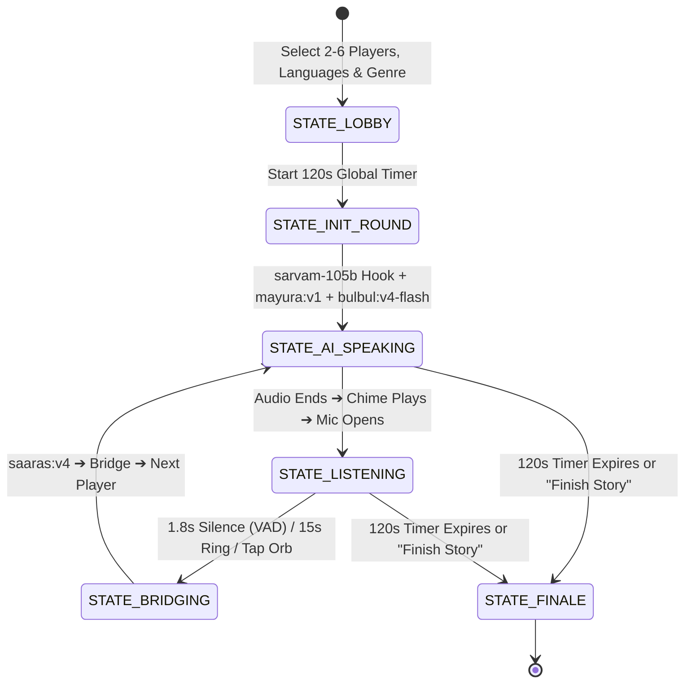

# 🚌 The Bus-Stop Storyteller

[](https://vercel.com/new/clone?repository-url=https://github.com/puruvats1/sarvam-storyteller&env=SARVAM_API_KEY)
[](https://sarvam-flax.vercel.app)
[](https://opensource.org/licenses/MIT)

An interactive, multilingual round-robin storytelling game powered by the **Sarvam AI** Indic intelligence stack.

Players gather around the bus stop, pass the microphone, and speak in their native Indian language. Sarvam AI translates, summarizes, and synthesizes speech into the next player’s ear in real time, ultimately weaving every turn into an entertaining collaborative story.

---

## 🌐 Live Production Deployment

* **Live App**: [https://sarvam-flax.vercel.app](https://sarvam-flax.vercel.app)
* **GitHub Repository**: [https://github.com/puruvats1/sarvam-storyteller](https://github.com/puruvats1/sarvam-storyteller)

---

## ⚡ The Sarvam AI Stack

All requests authenticate against `https://api.sarvam.ai` using your `SARVAM_API_KEY`:

| Layer | Model ID | Endpoint | Game Function |
| :--- | :--- | :--- | :--- |
| **Voice Capture (STT)** | `saaras:v4` | `POST /speech-to-text` (`mode="translate"`) | Converts any Indian language audio directly to English text in **~430ms**, eliminating a separate translation call. |
| **Story Master & Summarizer** | `sarvam-105b` | `POST /v2/chat/completions` | Generates the opening 1-line genre hook, compresses player turns into bridge summaries, and weaves the final cohesive 100-word story. |
| **Colloquial Localization** | `mayura:v1` | `POST /translate` (`mode="modern-colloquial"`) | Localizes story lines into the next speaker's language with natural spoken banter rather than textbook prose. |
| **Narrator Voice (TTS)** | `bulbul:v4-flash` | `POST /text-to-speech` (`pace=1.1`) | High-speed speech synthesis returning base64 WAV audio for immediate browser playback. |

---

## 🎮 Game Architecture & State Machine



1. **Lobby (`STATE_LOBBY`)**:
   - Register 2 to 6 players with names and languages (`hi-IN`, `bn-IN`, `ta-IN`, `te-IN`, `kn-IN`, `ml-IN`, `mr-IN`, `gu-IN`, `pa-IN`, `od-IN`, `en-IN`).
   - High-contrast tactile tokens automatically assigned.
   - Select a story genre (*Last Bus Home*, *Hostel Heist*, *Monsoon Mystery*, *Absurd Sci-Fi*).

2. **Opening Hook (`STATE_INIT_ROUND`)**:
   - Starts the 120-second game countdown.
   - `sarvam-105b` writes a punchy one-sentence opening hook, localized to Player 1's language via `mayura:v1`, and synthesized by `bulbul:v4-flash`.

3. **AI Speaking (`STATE_AI_SPEAKING`)**:
   - The central character creature pulses and speaks to the amplitude of the narration in Player 1's native language.

4. **Player Mic Capture (`STATE_LISTENING`)**:
   - An acoustic chime plays, and the mic opens.
   - Audio-reactive frequency deformation with a 15-second radial turn ring.
   - Turns end automatically via **1.8s continuous silence (VAD)** or by tapping the character.

5. **Bridge Summary & Handoff (`STATE_BRIDGING`)**:
   - `saaras:v4` translates speech directly to English in one step.
   - `sarvam-105b` produces a 1-sentence bridge summary (or bypasses it in Fast Direct Mode).
   - `mayura:v1` localizes into Player 2's language with modern colloquial slang.
   - `bulbul:v4-flash` speaks the bridge and hands the turn to Player 2.

6. **Multilingual Story Finale (`STATE_FINALE`)**:
   - Celebratory confetti burst.
   - `sarvam-105b` weaves all turns into a cohesive 100-word story.
   - Parallel `mayura:v1` requests generate native script story cards with inline TTS playback.

---

## 🔒 Security & Environment Variables

> **IMPORTANT**: API keys are **never** committed or hardcoded in source files.

* `.env` is explicitly excluded via `.gitignore`.
* Secrets are loaded strictly at runtime through `process.env.SARVAM_API_KEY`.
* An `.env.example` file is provided as a template:

```env
# Sarvam AI API Key (Get yours at https://dashboard.sarvam.ai)
SARVAM_API_KEY=your_sarvam_api_key_here

# Server Port
PORT=3000
```

---

## 🛠️ Local Development

### Prerequisites
* Node.js v18+ (tested on Node.js v24)
* npm v9+

### 1. Clone & Install
```bash
git clone https://github.com/puruvats1/sarvam-storyteller.git
cd sarvam-storyteller
npm install
```

### 2. Configure Environment
```bash
# Copy template and add your API key
cp .env.example .env
```
Add your key inside `.env`:
```env
SARVAM_API_KEY=sk_your_key_here
```

### 3. Build & Run
```bash
# Build the Vite frontend
npm run build

# Start the full-stack server
npm start
```
Open **[http://localhost:3000](http://localhost:3000)** in your browser.

---

## 🚀 Deploying to Vercel

### Option 1: 1-Click Deploy
Click the badge below to import the repository directly into your Vercel Dashboard:

[](https://vercel.com/new/clone?repository-url=https://github.com/puruvats1/sarvam-storyteller&env=SARVAM_API_KEY)

### Option 2: Vercel CLI
```bash
npm install -g vercel
vercel --env SARVAM_API_KEY=your_key_here --prod
```

---

## 📄 License
MIT © [puruvats1](https://github.com/puruvats1)
